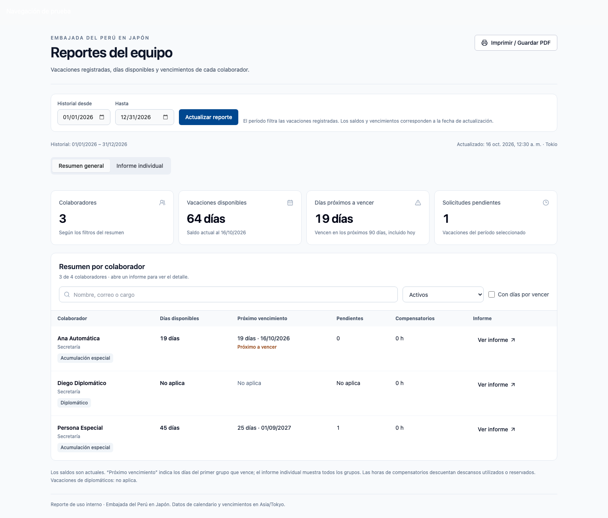
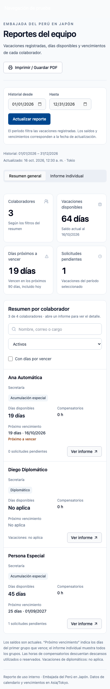

# Reportes generales e individuales

Implementación de las seis fases solicitadas para `/report`.

1. Datos: lecturas completas por lotes de 1.000 filas con orden único por ID; cualquier lote fallido aborta el informe. Ambas acciones requieren sesión de administrador activo y usan el cliente del usuario con RLS.
2. Diseño: resumen general e informe individual en pestañas, controles con etiquetas, tarjetas móviles y tabla de escritorio. El directorio y los reportes comparten la misma regla de saldo vigente: asignación iniciada, remanente positivo y vencimiento inclusivo, con fecha de Tokio.
3. Resumen: colaboradores activos por defecto, búsqueda por nombre/correo/cargo, consulta de inactivos y filtro de vencimientos en los próximos 90 días. Incluye diplomáticos con vacaciones “No aplica”. Los indicadores corresponden a las personas visibles.
4. Informe individual: registros disfrutados, en curso, programados, pendientes y cancelados; saldo actual agrupado por fecha de vencimiento; todas las asignaciones, sus notas y consumos de aprobación. Las excepciones dependen de autorización documentada, no de superar 40 días.
5. Impresión: imprime la vista seleccionada, sus filtros y fechas, sin navegación ni controles. El historial muestra 25 registros por página en pantalla e incluye todas las filas al imprimir. Las tablas repiten encabezados. El botón abre el diálogo del navegador, desde donde se guarda como PDF.
6. Validación y publicación: pruebas unitarias, navegador con datos ficticios, fechas de Tokio desde navegador en Los Ángeles, impresión y comprobación de producción de solo lectura.

## Semántica

- El período filtra vacaciones que se cruzan con las fechas seleccionadas. Si faltan fechas, se usa la fecha de solicitud. Los días de una solicitud se muestran completos; no se recalculan días laborables ni se prorratean por mes.
- El saldo de vacaciones y las horas de compensatorios son actuales al momento de la lectura, independientes del período del historial.
- Las canceladas se conservan en el historial, pero no suman días aprobados ni solicitudes pendientes. Los estados false/null corresponden a pendientes.
- Los compensatorios disponibles descuentan descansos utilizados o reservados de horas de trabajo aprobadas, excluyendo cancelaciones. Un saldo negativo se muestra para revisión.
- La diferencia entre otorgado y remanente se llama “utilizados o ajustados”. Los consumos existentes no constituyen un historial completo de todos los ajustes administrativos.
- Los remanentes vencidos, futuros o agotados no forman parte del saldo disponible. Las fechas manuales pasadas se muestran como pendientes de revisión.
- Las lecturas de las distintas tablas no son una instantánea transaccional; una aprobación concurrente puede requerir actualizar el reporte. Se evita mostrar como completo un informe con una lectura fallida.

## Comprobaciones realizadas

- 399 pruebas unitarias aprobadas; una prueba de integración existente omitida.
- 9 pruebas de interfaz en `pnpm test:report:ui`, sin conexión a Supabase ni cambios de datos.
- 2 pruebas de acceso anónimo aprobadas.
- TypeScript y compilación de producción aprobados.
- PDF ficticio de 28 registros revisado visualmente: tres páginas, todos los registros presentes y encabezados repetidos.
- Lectura de producción `vgtqgwjjtbkqiwhbplqi`, con transacción explícita de solo lectura: coincidencia con los saldos del directorio para todos los colaboradores; Uemise 39 (19+20), Oyanagi 21 (9+12), Tessy 45 (25+20), con sus vencimientos acordados.
- Verificación visual autenticada de producción completada: resumen general e informes individuales de Uemise, Oyanagi y Tessy. Se detectaron saldos negativos de compensatorios para Uemise y Tessy que requieren una revisión independiente de sus registros.
- Las capturas y PDF de pruebas usan rutas portables de Playwright; las pestañas se ajustan a 320 px también con fuentes de Linux.

Las capturas adjuntas contienen únicamente perfiles ficticios:

